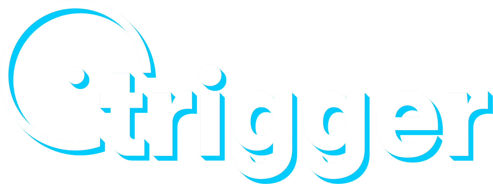

# trigger

Program for quick dictation and asks using the Meta Model API.

- **Ctrl+Alt+Q**: dictate into the focused field.
- **Ctrl+Alt+W**: ask a spoken question.
- **Ctrl+Alt+E**: same as above, but the answer shows in a card instead of pasting.

_*cough cough* muse.ai assistant integration would be nice *cough cough* please do it meta *cough* grok bot_

## License

[MIT](./LICENSE)
